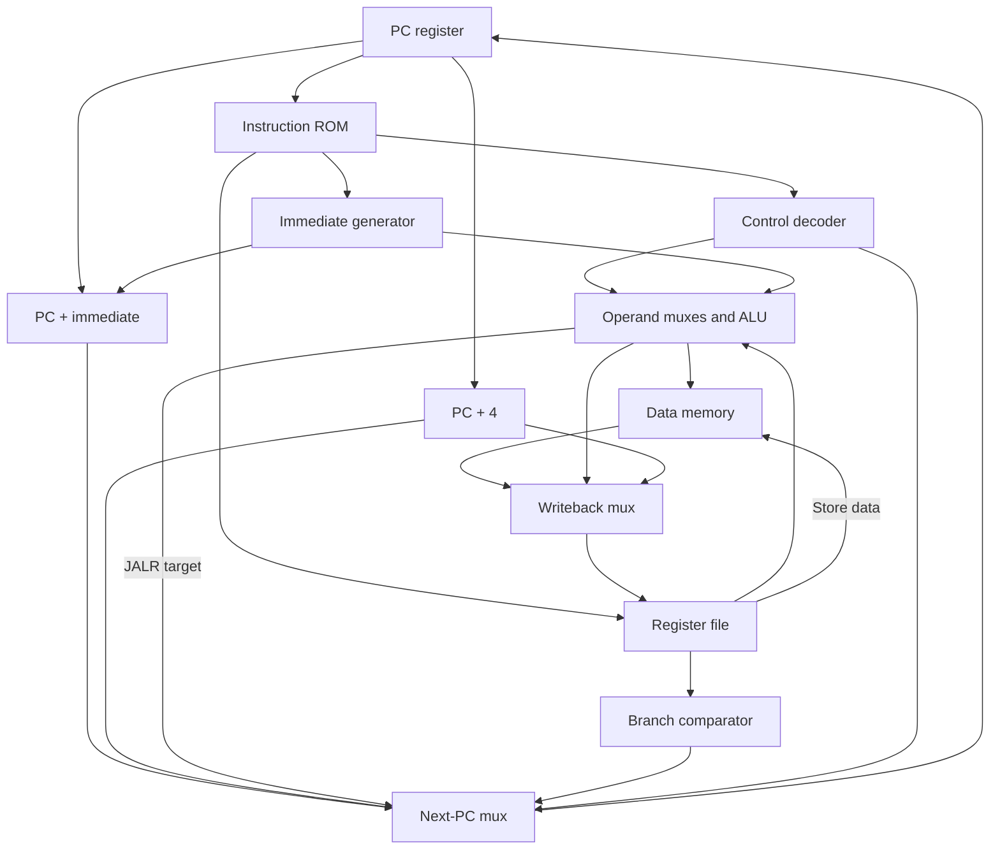

# Single-cycle RV32I processor

**Status: GNU assembly, all directed HDL regressions, and warning-free Verilator lint passed on 2026-10-23.** See [docs/verification.md](docs/verification.md) for the commands, tool versions, results, and verification limits.

This project contains synthesizable SystemVerilog RTL, five module testbenches plus a fault-policy test, two full-core program tests, and twenty fault scenarios. Executable instructions are written in assembly and must be built with the real RISC-V GNU tools. Generated `.hex`, `.elf`, `.lst`, and `.vcd` files were produced during verification. They are excluded from version control and regenerated by the build commands below.

## Design

- RV32I integer datapath, XLEN=32; no M/A/C/F/D, CSRs, interrupts, or privileged trap machinery.
- All ten register ALU operations and nine immediate ALU operations.
- LB/LH/LW/LBU/LHU; SB/SH/SW; all six branch conditions; JAL/JALR/LUI/AUIPC.
- FENCE is a no-op in the local ordered memory system. ECALL and EBREAK report terminal environment events through the isolated fault interface. FENCE.I and CSR instructions are rejected.
- A normal instruction completes between consecutive rising clock edges. Fetch, decode, execution, and load read are combinational; PC/register writes and stores commit on the rising edge.
- Synchronous, active-high reset: PC=0, x1..x31=0, fault cleared. x0 is hardwired to zero; no storage cell exists for it.
- Separate 1K-word instruction ROM and 4KB data memory, each addressed at 0x00000000–0x00000fff. Data memory is byte-addressable and little-endian.
- Data memory is not initialized or cleared by reset. Programs initialize locations before reading them. Reset suppresses stores and preserves data.
- Natural alignment required for halfwords/words; instruction addresses are four-byte aligned. Byte accesses may use any in-range address.
- Full 32-bit addresses are checked before indexing memory; high addresses cannot silently alias low memory.

The instruction ROM uses `$readmemh(HEX_FILE, mem)`. File loading is initialization rather than runtime hardware behavior. Synthesis support is target dependent: common FPGA flows support initialized ROM; an ASIC needs a ROM/memory implementation supplied by its technology flow. Combinational instruction and data reads are required for this single-cycle timing model; synchronous FPGA block RAM requires a different microarchitecture.



The diagram shows the data paths; control selects mux inputs and gates writes. Fault detection feeds `fault_unit`, whose `commit` output enables PC, register writeback, and stores. Fault checking does not depend on the resulting commit enable, so there is no combinational feedback loop.

### Datapath by instruction type

| Type | Data result | Next PC |
|---|---|---|
| Register arithmetic/logic | ALU(rs1, rs2) → rd | PC+4 |
| Immediate arithmetic/logic | ALU(rs1, sign-extended I immediate) → rd | PC+4 |
| Load | rs1+I immediate → address → extended memory data → rd | PC+4 |
| Store | rs1+S immediate → address; low byte(s) of rs2 → memory | PC+4 |
| Branch | Comparator tests rs1/rs2 | Taken: PC+B immediate; otherwise PC+4 |
| JAL | PC+4 → rd | PC+J immediate |
| JALR | PC+4 → rd; target uses the old rs1 even when rd=rs1 | (rs1+I immediate) with bit 0 cleared |
| LUI | U immediate → rd | PC+4 |
| AUIPC | PC+U immediate → rd | PC+4 |

Shift counts use only operand B bits [4:0]. SRA uses a signed left operand for arithmetic right shift. SLT/BLT/BGE use signed comparisons; SLTU/BLTU/BGEU use unsigned comparisons. I/S/B/J immediates are sign-extended; U immediates append twelve zero bits. B/J immediates already include their low zero bit and are not shifted a second time.

A load is the expected critical path: PC → ROM → register read/decode → ALU → memory read → writeback → register setup. This project supplies no frequency, timing-closure, area, or technology-mapping claim.

## Files and interfaces

| File | Interface / responsibility |
|---|---|
| `rtl/rv32i_pkg.sv` | Shared enums and packed control word |
| `rtl/pc.sv` | clk, rst, enable, next_pc → current_pc |
| `rtl/regfile.sv` | rs1/rs2 → two reads; synchronous rd/write_data port |
| `rtl/alu.sv` | a, b, alu operation → 32-bit result |
| `rtl/imm_gen.sv` | instruction bits [31:7], immediate format → 32-bit immediate |
| `rtl/control_unit.sv` | Full instruction → validated controls and decode event |
| `rtl/branch_unit.sv` | rs1 data, rs2 data, funct3 → branch taken |
| `rtl/data_mem.sv` | Requests, address, width, sign mode, store data, commit → load data/access checks |
| `rtl/instr_mem.sv` | PC address → instruction/access checks; HEX_FILE parameter |
| `rtl/fault_unit.sv` | Event → synchronous sticky fault/cause and combinational commit gate |
| `rtl/riscv_core.sv` | Integration, PC adders, muxes, event priority |

Top-level inputs are `clk` and `rst`. Outputs are `fault`, `fault_cause`, `debug_pc`, and a store observation interface (`store_valid`, `store_address`, `store_data`, `store_size`). Observe store signals at the rising edge; they describe the store committing on that edge. The interface does not create a second memory port. Testbench completion addresses 0xff0 and 0xff4 are ordinary RAM locations, not RTL MMIO devices.

All sequential RTL uses nonblocking assignments in `always_ff`; combinational RTL uses continuous assignments or fully assigned `always_comb` blocks. The only initialization construct is instruction ROM loading. Testbench delays, prints, waveform dumps, and fatal assertions stay outside the RTL.

## Isolated fault interface

`fault_unit.sv` contains all sticky fault state and the global commit policy. Its input is one combinational `event_cause`. A detected event suppresses writes on the faulting edge and latches fault/cause. The PC remains at the faulting instruction until synchronous reset, except for a fetch fault after a valid out-of-range jump: that jump already committed its link, and PC identifies the inaccessible target.

| Cause | Value | Meaning |
|---|---:|---|
| FAULT_NONE | 0 | No event |
| FAULT_ILLEGAL | 1 | Unsupported or invalid encoding |
| FAULT_I_ALIGN | 2 | Current fetch or taken control-transfer target is misaligned |
| FAULT_I_ACCESS | 3 | Current instruction fetch is outside ROM |
| FAULT_D_ALIGN | 4 | Misaligned active data access |
| FAULT_D_ACCESS | 5 | Active data access outside RAM |
| FAULT_ECALL | 6 | Environment call |
| FAULT_EBREAK | 7 | Breakpoint |

Priority is current-fetch alignment, current-fetch range, decode event, taken-target alignment, data alignment, then data range. Untaken branches do not check target alignment. Loads to x0 still perform access validation.

Set top-level `ENABLE_FAULTS=0` to synthesize out the stopping policy. This mode is intended for integration with another execution environment, not for claiming fault semantics: illegal encodings safely skip, invalid data accesses are locally blocked (invalid loads return zero), and invalid fetches produce a zero instruction. To remove the policy module physically, replace its instance with `commit = !rst`, `fault = 0`, and `fault_cause = FAULT_NONE`, then remove `fault_unit.sv` from the file list. Memory bounds checks remain local and decoder validation remains in `control_unit`.

## Control tables

See [docs/control.md](docs/control.md) for opcode controls, complete ALU subdecode, branch conditions, memory widths, and immediate formats.

## Build and run

Run these commands from this project directory. Required tools: Python 3, GNU Make, RISC-V GNU binutils (`as`, `ld`, `objcopy`, `objdump`, `nm`), Icarus Verilog, Verilator with timing support, and optionally GTKWave.

```bash
make programs                  # assemble, link at PC=0, objcopy, objdump, produce hex
make unit                      # assemble and run module tests
make test                      # module tests first, then sum, ISA and twenty fault tests
make lint                      # Verilator -Wall on RTL and every testbench
make all                       # tests + lint
make wave                      # opens build/sum.vcd after a successful test run
```

The default tool prefix is `riscv32-unknown-elf-`. A GNU RISC-V toolchain named `riscv64-unknown-elf-` can also generate RV32I/ILP32, when it supports ELF32:

```bash
make all CROSS=riscv64-unknown-elf-
```

The source-build script requires real GNU executables. It has no hand-encoding fallback. The explicit commands for the sample program are:

```bash
mkdir -p build
riscv32-unknown-elf-as -march=rv32i -mabi=ilp32 -mno-relax -o build/sum.o programs/sum.S
riscv32-unknown-elf-ld -m elf32lriscv --no-relax -T programs/link.ld -o build/sum.elf build/sum.o
riscv32-unknown-elf-objcopy -O binary --only-section=.text build/sum.elf build/sum.bin
riscv32-unknown-elf-objdump -d -M no-aliases,numeric build/sum.elf
# make programs also converts the GNU binary into the word-oriented programs/sum.hex.
```

The linker step is essential: branch/jump and address pseudo-instruction relocations must be resolved before extracting bytes. `programs/link.ld` places text at zero. Relaxation and compressed instructions are disabled. The converter groups four little-endian binary bytes into one 32-bit hex word per line, then pads the ROM to 1,024 words with zero data. It compares every objdump instruction record to objcopy bytes and verifies the hex byte round-trip. No valid instruction is hand-encoded. `.word` entries in `imm_vectors.S` are expected immediate DATA, not opcodes; unused zero ROM padding is deliberately illegal if executed.

Compile and simulate the sample directly after `make programs`:

```bash
iverilog -g2012 -Wall -s tb_core -o build/sum.vvp -f rtl/files.f tb/tb_core.sv
vvp build/sum.vvp +VCD=build/sum.vcd
gtkwave build/sum.vcd
```

Compile a module test directly:

```bash
iverilog -g2012 -Wall -s tb_alu -o build/tb_alu.vvp -f rtl/files.f tb/tb_alu.sv
vvp build/tb_alu.vvp
```

Lint commands (no warning suppression and warnings remain fatal):

```bash
verilator --lint-only -Wall --top-module riscv_core -f rtl/files.f
verilator --lint-only --timing -Wall --top-module tb_core -f rtl/files.f tb/tb_core.sv
```

`make lint` additionally checks every other testbench. This gate passed without warnings on 2026-10-23. Icarus emits simulator-specific diagnostics during compilation; the warning-free result refers to Verilator.

## Sample program and test behavior

`programs/sum.S` sums 1 through 10, stores 55 at data address 0x100, loads it back into t3, and writes success value 1 to 0xff0. It then loops. A mismatch writes 0xffffffff to 0xff0. The testbench checks the signature, stored byte order, loaded register, x0, unexpected faults, and a 3,000-cycle timeout, and prints PASS or terminates with `$fatal` and FAIL. The generated address/machine-code/disassembly listing will be `build/sum.lst`; the generated ROM image will be `programs/sum.hex`.

`programs/isa.S` performs directed instruction checks. Failed checks store their ID at 0xff4 before writing the failure signature. `programs/faults.S` is assembled twenty times with GNU `--defsym CASE=N`; linked symbols supply expected fault PC and preserved a0 values automatically. There are no guessed PC constants in the regression driver.

See [docs/coverage.md](docs/coverage.md) for the directed test map. All listed regression tests passed; this is not a formal or exhaustive architectural compliance result. Running `make all` regenerates local regression and lint logs in `logs/all.log` and `logs/lint.log`; these logs are excluded from version control.
